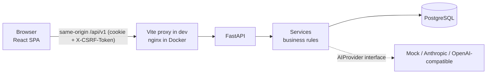

# Architecture

ShipTrack is a classic three-tier app: a React single-page app, a FastAPI JSON API, and PostgreSQL.



## Backend layering

| Layer | Location | Responsibility |
|---|---|---|
| Routes | `app/api/v1/*` | Parse/validate HTTP, call one service function, return a schema. **No business logic.** |
| Dependencies | `app/dependencies.py` | DB session, authenticated user, CSRF check (so a route can't forget it). |
| Services | `app/services/*` | All rules: permissions, transitions, key generation, activity logging, transactions. |
| Models | `app/models/*` | SQLAlchemy 2.x tables, constraints, indexes. |
| Schemas | `app/schemas/*` | Pydantic request/response models (the API contract + OpenAPI). |
| Core | `app/core/*` | Config validation, security helpers, error envelope, rate limiter. |

Decision: there is **no separate `repositories/` layer**. Services talk to SQLAlchemy directly. For an app this size
a repository layer would only forward calls (the brief asks to avoid needless abstraction). If queries get reused
across many services, extract them then.

### Request flow (example: `PATCH /issues/{id}`)
1. `get_current_user` reads the session cookie, loads the session row, and for non-GET requests verifies the CSRF header.
2. The route validates the body with `IssueUpdate` and calls `issues.update_issue`.
3. The service loads the issue **through the membership-scoped query** (non-members get 404), locks the row, validates
   the status transition and assignee membership, writes the change plus `issue_activities` rows, and commits once.

## Authentication & session design

Chosen strategy: **server-side sessions in HTTP-only cookies**.

* Login creates a random 256-bit token. The browser gets it as an `HttpOnly`, `SameSite=Lax` cookie
  (`Secure` in production). Only an HMAC of the token is stored in the `sessions` table.
* **Logout deletes the row**, so a stolen cookie stops working immediately (unlike a stateless JWT).
  Changing your password also signs out all your other sessions.
* **CSRF:** cookies are sent automatically by browsers, so state-changing requests must also carry
  `X-CSRF-Token`. The token is `HMAC(secret, session_token)`; the SPA receives it from `/auth/me` / login and keeps it
  **in memory only**. `SameSite=Lax` is a second layer.
* **XSS:** the session cookie is not readable by JavaScript; React escapes output; nginx sends a strict CSP.
* **Brute force:** per-IP and per-account rate limits on login, Argon2id hashing, and a dummy hash on unknown emails
  so timing doesn't reveal which emails exist. Login errors are always the same generic message.
* Passwords: Argon2id (library defaults), 8–128 chars, at least one letter and one digit.

## Authorization model

Two roles per project: `OWNER` and `MEMBER`.

| Action | Owner | Member | Non-member |
|---|---|---|---|
| View project / issues / activity | ✅ | ✅ | 404 |
| Create & edit issues, change status | ✅ | ✅ | 404 |
| Delete issue | ✅ | only own reported issues | 404 |
| Edit / archive / delete project | ✅ | 403 | 404 |
| Add / remove members | ✅ | 403 | 404 |

* Non-members get **404, not 403**, so the existence of other people's projects/issues isn't leaked.
* Every issue query starts from `accessible_issues(user)` (issues whose project the user belongs to). It is hard to
  forget because it is the only way services fetch issues.
* Invariant: an assignee must be a member of the issue's project. It's enforced on create/update, and removing a member
  unassigns their issues (with an activity entry).
* Archived projects are read-only (409 on writes).

## Issue numbering

Each project has `issue_counter`. Creating an issue does `SELECT … FOR UPDATE` on the project row, increments the
counter, inserts the issue, and writes the activity in **one transaction**. Concurrent creators serialize on the row
lock, so numbers are unique and gapless; `UNIQUE(project_id, issue_number)` is the safety net.

## AI bug-report assistant

```
POST /api/v1/ai/structure-bug-report  {report}
   → rate limit → length check → provider.generate_draft() → BugReportDraft (strict Pydantic) → {draft}
```

* `AIProvider` is a tiny interface (`generate_draft(report) -> dict`). Implementations: `mock` (offline, deterministic),
  `anthropic` (forced tool call for structured output), `openai` (JSON mode; works with compatible gateways).
  Select with `AI_PROVIDER`, `AI_MODEL`, `AI_API_KEY`, `AI_BASE_URL`.
* The endpoint **only returns a draft**. Saving goes through `POST /issues`, and the UI requires an explicit
  "Use this draft" click, after which every field is an ordinary editable form field.
* The prompt tells the model to use only facts in the report and to leave fields empty rather than invent
  them. The report is wrapped in `<bug_report>` tags and treated as data (a basic prompt-injection mitigation, not a guarantee).
* Output is validated against `BugReportDraft` (`extra="forbid"`, enum priority, length caps). Failures map to clean
  errors: timeout → 504, provider down/misconfigured → 503, provider rate limit → 429, malformed → 502. Every message
  tells the user manual creation still works.
* Privacy: report text is never logged or stored; provider error bodies are never forwarded; the API key stays on the backend.

## Error format

All errors: `{"error": {"code": "...", "message": "...", "details": ...}}`. Validation errors list `{field, message}`.
Unhandled exceptions are logged server-side and returned as a generic 500.

## Frontend structure

`api/` (typed fetch client + endpoint functions) · `hooks/queries.ts` (TanStack Query hooks, one invalidation helper)
· `features/` (auth context, issue list/filters, AI assistant, project components) · `pages/` (route components) ·
`schemas/` (Zod, mirroring server rules) · `components/ui.tsx` (accessible primitives).
Server state lives in TanStack Query; filters live in the URL so views are shareable and survive refresh.
