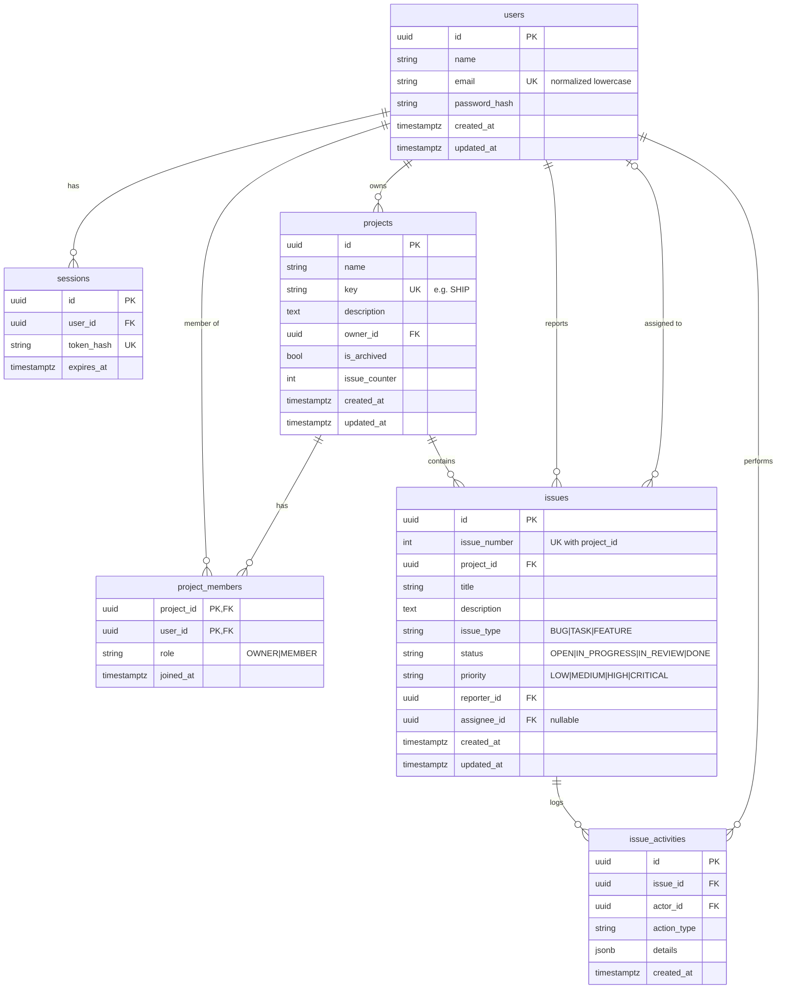

# Database design

PostgreSQL 16, SQLAlchemy 2.x models, Alembic migrations (`backend/alembic/versions`). The schema is **only** created
by migrations. The test-suite applies them to an empty database, which keeps them honest.

## Relationships and decisions

* **users ↔ projects** is many-to-many through `project_members`. The composite primary key
  `(project_id, user_id)` is the uniqueness constraint. `projects.owner_id` is kept (as the brief's field list says)
  *and* the owner also has an `OWNER` membership row, which makes "projects I belong to" a single join.
* **`projects.key`** (not in the brief's suggested columns) is the "project identifier" used to build keys such as
  `SHIP-101`. It is globally unique so a key identifies exactly one issue. The key is **computed** from
  `project.key + issue_number`; it is never stored on the issue (no redundant data).
* **`issues`**: `UNIQUE(project_id, issue_number)`. `issue_counter` on the project hands out numbers under a row lock.
* **Enums** are `VARCHAR` + `CHECK` constraints (not native PG enums): invalid values are rejected by the database, and
  adding a value later is a simple migration. Tests verify the constraint.
* **Cross-project assignment** can't be expressed with a plain FK, so the service enforces it; removing a member unassigns
  their issues in that project.
* **Delete behavior**

  | Parent deleted | Children | Why |
  |---|---|---|
  | project | members, issues, activities **CASCADE** | deleting a project removes its data |
  | issue | activities CASCADE | history belongs to the issue |
  | user (not exposed in the API) | reporter / owner / actor: **RESTRICT**; assignee: SET NULL; sessions: CASCADE | never silently lose authorship |

* **Indexes**: unique `users.email`, `projects.key`, `sessions.token_hash`; FK indexes (`owner_id`, `reporter_id`,
  `assignee_id`, `project_members.user_id`); composites `(project_id, status)` and `(project_id, priority)`;
  `issues.issue_type`, `issues.updated_at`; `(issue_id, created_at)` on activities.
* **Timestamps** are `timestamptz`. Activity timestamps use `clock_timestamp()` so rows written in one transaction still
  order correctly.
* **`issue_activities.details`** is JSONB holding field names and old/new values only. Never description text,
  credentials, or tokens.

## Known limitation

Search uses `ILIKE '%term%'` (wildcards escaped). That's fine for thousands of issues; for large datasets add a
`pg_trgm` GIN index or Postgres full-text search.
